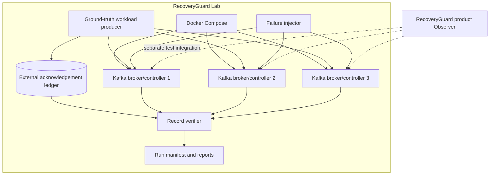

# RecoveryGuard Lab Architecture

**Document type:** Test-system architecture  
**Status:** Current Lab implementation

## 1. Purpose

RecoveryGuard Lab is an independent test system for controlled Kafka failure experiments. It provides a repeatable Kafka topology, a workload generator, an external acknowledgement ledger, failure-event recording, and a record verifier.

The Lab provides independent evidence to evaluate product observations. It does not contain or execute RecoveryGuard product implementation.

## 2. Architecture

The product Observer is an external test participant. It is not a Lab dependency. The ground-truth verifier does not consume product verdicts.

## 3. Kafka topology

The current Compose environment runs three Apache Kafka 4.4.0 nodes. Each node has both broker and controller roles. All three nodes take part in the KRaft controller quorum.

| Property | Current value |
|---|---|
| Kafka image | `apache/kafka:4.4.0` |
| Node count | 3 |
| Process roles | broker, controller |
| Controller quorum | 3 voters |
| Default replication factor | 3 |
| Minimum in-sync replicas | 2 |
| Host listeners | PLAINTEXT |
| Broker log directory | Temporary filesystem |

This is a disposable development topology. It is not a production reference architecture. It does not model separate controller nodes, rack-aware placement, persistent storage, TLS, or Strimzi operation.

## 4. Ground-truth subsystem

The `ground-truth/` Maven module contains:

| Component | Responsibility |
|---|---|
| `WorkloadProducer` | Produces uniquely identified records |
| `DurableEventWriter` | Writes durable event records |
| `EventLedger` | Maintains the append-only run ledger |
| `FailureRecorder` | Records operator-defined failure events |
| `RecordVerifier` | Reads topic records and compares them with the ledger |
| `RunStore` | Creates and loads run manifests and evidence files |
| `GroundTruthCli` | Exposes recorder operations through the command line |

The ledger is stored on the host, outside the Kafka broker containers. It is independent of product storage and verdict code.

## 5. Experiment lifecycle

1. Start the Kafka cluster and run the smoke test.
2. Create a fresh topic with an explicit replication and retention policy.
3. Create a unique experiment run and manifest.
4. Start the ground-truth producer.
5. Record the failure start.
6. Inject the failure using the scenario procedure.
7. Restore the failed component and record the failure end.
8. Wait for the producer to finish.
9. Run the record verifier.
10. Preserve the manifest, ledger, report, logs, and configuration.

A run must not reuse a topic from an earlier experiment. Topic reuse can introduce records that are not part of the current ledger and invalidate the result.

## 6. Independence and trust model

The Lab is the independent test oracle for controlled experiments. It must not use RecoveryGuard's verdict output to decide whether records were preserved.

The ledger records producer intents and outcomes. The verifier compares confirmed acknowledgements with records found in Kafka. Unknown producer outcomes remain explicit.

The ledger hash chain detects certain changes to the ledger. It does not provide cryptographic source authentication or protection against an actor who can rewrite the complete ledger and recompute the chain.

## 7. Current limits

- The current cluster uses combined broker/controller nodes.
- The current cluster uses plaintext listeners.
- Broker data is temporary and is removed when containers are removed.
- RG-00 covers active partition-leader failure in its recorded configuration.
- The current topology does not establish behaviour for every Kafka failure mode.
- The verifier's PASS result is limited to the topic scan and run manifest.
- KRaft quorum health, reassignment correctness, application invariants, and platform orchestration require separate evidence and scenarios.

## 8. Change control

Changes to topology, failure scripts, workload semantics, ledger schema, verifier rules, and run manifest fields must include updated documentation and tests.

Each experiment result must identify the exact topology and configuration used. Do not apply a result from one profile to a different Kafka deployment without additional tests.
